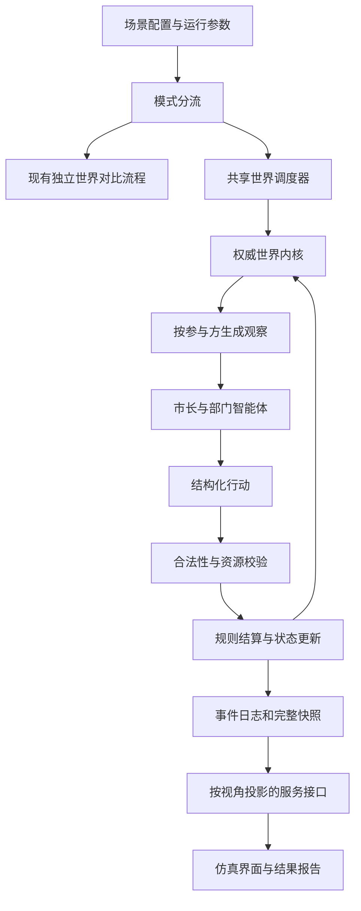

# 对抗模式修改方案

> 编写日期：2026-11-12。基于当前本地工程及上游 `188841d26` 的代码结构。本文是设计与工作量估算，文中新增字段、接口和模块均为拟议内容，尚未实现。

## 1. 目标与边界

在保留现有独立世界策略对比的基础上，新增“共享世界交互模式”：两个或多个参与方拥有各自目标、资源和可见信息，其行动通过明确规则共同改变一个世界。

“交互”可以表现为竞争、合作或对抗，不要求所有场景都有唯一赢家。例如两城竞争人才时，可以分别评价经济成长和城市吸引力，并允许双方同时改善。

首个落地场景建议为“双城人才竞争”：两位市长初始人格、城市基础和财政预算相同，政策不同，面向同一个人才市场作出决策。引才成本、人才选择和公共服务压力通过共享状态相互影响。

### 1.1 首版范围

- 两个参与方，轮流行动，每轮开始公布一次共同外部事件。
- 一个权威共享世界，包含公共状态、各方私有状态和人才实体。
- 使用预先注册的行动及确定性结算规则，模型只负责在规则内决策和解释。
- 支持启动、取消、结果保存、历史查看和事件播放。
- 支持基于已记录行动重新执行结算，验证状态是否一致。
- 支持在完整回合边界创建分支，修改后续策略。
- 提供研究者全局视图；参与方仅获得授权的观察数据。
- 保留现有场景、运行入口和汉化、自定义模型支持。

首版不包含任意多方、同时行动、复杂联盟、真人在线对抗、跨组织账户权限体系，也不承诺模型重新调用后的输出完全一致。

## 2. 当前工程能力及差距

| 现有模块 | 当前作用 | 与共享世界对抗的差距 |
|---|---|---|
| `src/cli/pair-runner.ts` | 分别启动各决策者的运行并比较结果 | 多次运行各自持有内核，并非同一世界中的双方 |
| `src/runtime/orchestrator/index.ts` | 单个决策者下的事件、部门分析、决策和状态更新 | 缺少多个独立参与方的阶段调度与共同结算 |
| `src/engine/core/kernel.ts` | 保存单次运行状态，处理种子随机数、政策和事件效果 | 状态围绕一个领导者及其人口组织，需要适合交互场景的状态结构 |
| `src/engine/types.ts` | 场景、角色、指标和钩子类型 | 没有明确的阵营、行动协议、信息可见性与冲突规则 |
| `src/runtime/validators/` | 校验模型返回的结构化内容 | 结构正确还不能证明行动合法、资源足够或目标可见 |
| `src/server/server-app.ts`、`src/server/routes/` | 运行控制、SSE 和历史服务 | 需要模式分流，以及按观察者生成数据投影 |
| `src/dashboard/src/hooks/useGameState.ts` | 将各角色事件归并为界面状态 | 当前主要按独立角色世界组织，缺少比赛阶段和共享环境 |
| `src/dashboard/src/components/sim/` | 多列仿真、时间线、决策展示 | 需呈现行动顺序、共同结算及行动对对方的影响 |
| `src/engine/schema/`、`schema/` | 运行记录和流事件协议 | 需要保存参与方观察、行动、拒绝原因及共同状态变更 |
| `src/runtime/world-model/index.ts` | 单次运行的回放、分支等能力 | 共享世界必须整体恢复，不能仅恢复一方 |

可以复用 AgentOS 模型调用、Zod 校验、费用统计、研究记忆、工具适配、服务器基础设施和部分界面组件。不能直接将两个现有内核放在一起，然后用文本消息声称它们共享世界。

现有 `scenarios/city-talent-policy.json` 是独立世界对比的配置原型；它的相同年度事件可以复用，但人才流动和预算约束仍需新结算模块才能成为硬规则。

## 3. 总体架构



运行调度放在 `src/runtime/`，规则结算与状态定义放在 `src/engine/`。遵守现有边界：引擎不依赖运行时，也不调用模型。

建议在现有顶层目录下增加 `src/engine/core/interaction/` 和 `src/runtime/orchestrator/interaction/`，并在架构文档中记录职责。模块名称可在实施时调整。

## 4. 场景配置修改

### 4.1 兼容策略

新增显式模式字段，例如 `simulationMode`，取值 `comparison` 或 `interaction`。没有字段的旧场景继续走现有路径；模式不明或交互配置不完整时，应在启动前报错，不得静默退回独立运行。

新增独立的交互配置校验器，识别参与方引用、指标路径、行动目标、预算单位和结束条件。先由人工编写并校验配置，再扩展场景生成器；首版不让模型生成任意结算代码。

以下仅为结构示意，不能直接作为当前系统可运行的配置：

```json
{
  "id": "city-talent-competition",
  "simulationMode": "interaction",
  "interaction": {
    "turnMode": "alternating",
    "rounds": 8,
    "initiative": "rotate-each-round",
    "participants": [
      { "id": "city-a", "actorRef": "mayor-a", "policyRef": "direct-incentives" },
      { "id": "city-b", "actorRef": "mayor-b", "policyRef": "development-environment" }
    ],
    "initialWorld": {
      "shared": { "availableTalent": 1000 },
      "participants": {
        "city-a": { "policyFunds": 80, "gdpIndex": 100, "attractiveness": 50 },
        "city-b": { "policyFunds": 80, "gdpIndex": 100, "attractiveness": 50 }
      }
    },
    "actionSet": "city-talent-v1",
    "observationPolicy": "city-talent-visibility-v1",
    "resolutionRules": "city-talent-rules-v1",
    "termination": { "type": "round-limit", "rounds": 8 },
    "evaluation": { "primaryMetrics": ["gdpIndex", "attractiveness"] }
  }
}
```

`actionSet`、`observationPolicy`、`resolutionRules` 指向工程内注册并测试的模块，不是自动存在的插件。示例中的人才数量、资金和初始分数都是实验参数。

### 4.2 必须结构化的内容

| 配置内容 | 含义 |
|---|---|
| 参与方与角色归属 | 哪些市长、部门和资源属于哪座城市 |
| 政策参数 | 各类支出占比、调整范围、期限和可用资金 |
| 行动集合 | 行动类型、参数范围、目标类型、费用和执行条件 |
| 状态可见性 | 公共数据、本方数据、对手不可见信息及发布延迟 |
| 行动顺序 | 每轮先手、轮换规则、观察与结算时点 |
| 冲突与随机性 | 同一资源被争夺时如何分配，如何使用种子随机数 |
| 结束与评价 | 回合上限、资源耗尽处理、经济成长与吸引力口径 |

人格与政策应独立配置。政策方向、支出比例、资金上限必须由校验和结算落实，不能仅放进市长提示词。为隔离人格影响，实验模式还需关闭人格漂移，或向双方应用同样的外生人格轨迹。

## 5. 共享世界内核与规则

### 5.1 状态划分

- `shared`：人才市场、共同产业周期、公共事件与公开信息。
- `participants`：各城资金、经济产出、吸引力、政策执行计划及私有信息。
- `entities`：人才、岗位、科研项目等实体及其当前归属、状态。
- `phase`：回合号、当前行动方、阶段、待处理行动与终局标记。
- `randomState`：随机数状态、抽样记录或足以恢复它们的完整数据。

权威状态只保存在内核。智能体通过工具提交行动，不能直接写状态。资金使用统一最小单位或明确的小数精度，避免累计浮点误差破坏守恒。

### 5.2 首版回合流程

1. 生成或读取本轮共同外部事件，只执行一次公共环境更新。
2. 依据先手规则确定行动顺序；每轮轮换先手。
3. 为当前参与方构建观察快照，部门分析后由市长提交行动。
4. 校验行动结构、权限、预算、政策范围、目标和时效。
5. 原子结算合法行动，记录资源消耗、状态变化和公开结果。
6. 为另一方重新构建观察，按相同步骤执行；允许其看到已公开的先手行动结果。
7. 执行一次年度结算：人才选择、项目进展、住房压力和经济变化。
8. 计算指标，判断结束条件，保存完整回合快照。

轮流行动天然包含后手信息优势。首版通过轮换先手及交换初始顺序重复实验控制影响；如果研究问题要求双方互不知晓当轮行动，必须采用后续的同时提交、统一结算模式。

### 5.3 双城场景的最小规则

- 年度预算从可用资金中实际扣除，同一笔资金不能被两个行动重复使用。
- 政策A与政策B的允许支出项目和比例范围由程序校验。
- 人才从共享市场进入某城或留在市场，同一人才不能同时属于两城。
- 人才选择考虑配置中的岗位匹配、生活成本、政策条件和随机因素；公式、参数和版本需记录。
- 科研平台及成果转化有建设状态和时间滞后，启动投资不等于当年经济增长。
- 经济产出与吸引力通过已定义的规则更新，不能由模型自行填最终分数。
- 人口、人才、财政和项目状态分别核算，不把代表性居民样本直接当成真实城市人口。

参数应先作为可审查的假设，后续再使用数据或专家评审校准。规则实现正确与现实预测准确是两项不同的验收工作。

## 6. 智能体、工具与运行调度

新增交互调度器；现有 `runSimulation` 保持兼容。市长和部门会话按“运行ID＋参与方ID＋角色ID”隔离，使用相同模型配置时也不能共享私有记忆。

首版行动输出可以采用以下协议：

```json
{
  "type": "allocate-policy-budget",
  "parameters": { "program": "housing-support", "amount": 2 },
  "reason": "在当前政策允许范围内缓解住房压力"
}
```

参与方身份由服务器会话绑定，不信任模型填写的身份。行动记录另附回合号、幂等键和观察版本；状态版本过期或请求重复时不得重复扣款。

工具建议拆为读取工具和提交工具：

- 读取本方状态、公开市场、可见事件与合法行动列表。
- 执行假设分析，但分析工具不能提交真实状态修改。
- 提交结构化行动，由内核统一校验和执行。

保留现有模型结构校验和反馈重试，增加业务合法性反馈。超过重试上限、模型超时或无合法行动时，按场景定义执行“跳过”或安全默认行动，并记录原因，不能让模型无限重试。

动态生成的工具首版仅用于分析，不得获得直接修改权威状态的权限。工具注册表、输入、输出和日志同样按参与方隔离；公开共享需要显式规则。

## 7. 接口、事件、保存与回放

### 7.1 服务端

现有启动入口增加模式分流，交互模式启动一次比赛，而不是为每方启动一次独立比赛。运行的取消、并发限制和费用上限以整场比赛计，同时记录各方费用。

建议增加以下逻辑事件，最终命名需与已有流协议统一：

| 事件 | 用途 |
|---|---|
| `match_started` | 比赛ID、参与方、规则版本和初始公开状态 |
| `round_started` | 年度事件、先手与阶段 |
| `participant_turn_started` | 当前行动方与可见观察版本 |
| `action_rejected` | 行动拒绝、允许公开的原因及重试情况 |
| `action_resolved` | 已执行行动、费用与授权可见的状态变化 |
| `round_resolved` | 年度共同结算、双方指标和资源核对结果 |
| `match_finished` | 结束原因、评价结果和记录引用 |

公共流不能携带完整私有观察。服务端在序列化之前进行视角投影；不能仅依靠前端隐藏元素。原始提示词、工具参数和模型错误预览也需遵守相同规则。

当前工程主要按访客区分运行，不应将其当作完整的多人身份权限体系。首版研究者全局视图限运行所有者在受控环境中使用；对外提供真实参与方登录和旁观访问时，需要另行实现身份、成员关系和授权。

### 7.2 记录格式

建议新增带版本和类型标识的交互运行记录，存储完整共享状态、参与方、规则参数、行动日志、指标轨迹和快照。旧运行记录不改写，历史加载器通过类型分流。

需要同步处理运行记录校验器、JSON Schema 导出、Library 导入导出、下载和历史读取。旧客户端遇到不支持的新记录类型时，给出明确提示，不能按旧报告误读。

### 7.3 播放、验证与分支

- 事件播放：按历史事件展示已发生的过程，不重新调用模型。
- 结算验证：从初始快照重放已接受的行动、外部事件和随机抽样，核对共享状态与指标；记录引擎及规则版本。
- 分支：首版只允许在完整回合边界恢复整个世界，包括双方资源、人才归属、随机数状态及各方有效记忆，再改变后续政策。

事件播放不等于结算验证。模型重新决策形成新分支，也不属于完全确定性的历史重放。运行记录保存完整机密状态时，下载与分享必须受访问权限约束。

## 8. 界面修改

### 8.1 设置与场景编辑

- 增加模式标识，区分“独立世界对比”和“共享世界交互”。
- 展示参与方、政策、初始资源、年度预算、行动顺序、结束条件。
- 对初始人格和政策差异提供摘要，支持关闭人格漂移。
- 校验失败时指出具体配置位置，所有新增文案使用中文。

### 8.2 仿真页

可复用左右分栏外观，但重新定义数据来源：

```text
共享环境：第3年 | 当前行动方：乙城 | 人才市场 | 共同外部事件
┌───────────────────────┬───────────────────────┐
│ 甲城：资源、政策、行动 │ 乙城：资源、政策、行动 │
│ 可见分析与决策依据     │ 可见分析与决策依据     │
└───────────────────────┴───────────────────────┘
本轮共同结算：资金扣除、人才归属变化、经济与吸引力变化
时间线：公共事件 → 甲城行动 → 乙城行动 → 年度结算
```

用明确标记区分“正在分析”“行动被拒绝”“行动已执行”和“年度结算完成”。一次行动成功不等同于整场获胜。窄屏下改用参与方切换和共享环境摘要。

### 8.3 可视化与报告

首版增加简洁的共享资源与人才流向视图，避免将既有殖民地人口网格直接解释成城市人才市场。

报告分别展示双方经济产出指数、累计成长、吸引力轨迹、政策成本及人才流动；说明共同事件、先手顺序、模型、随机种子和规则版本。不默认合成单一胜负分。

如果以后开放参与方视角，前端切换只能请求服务端已授权的数据；研究者权限不能由一个普通的 URL 参数或浏览器下拉框授予。

## 9. 测试与验收

### 9.1 必须通过的自动化检查

1. 旧配置与旧运行记录继续加载，既有模式不被错误分流。
2. 同一笔资源不能重复消费，重复行动不会产生第二次效果。
3. 非本方资源、不可见目标、越界政策参数与过期行动被拒绝。
4. 双方观察、模型上下文、工具和SSE中不存在未授权的对手数据。
5. 人才归属唯一，市场与城市之间的流动满足约定的数量守恒规则。
6. 轮换先手、模型重试、跳过、取消与资源耗尽有明确且可复现的结果。
7. 相同初始状态、行动序列、规则版本和随机状态产生一致结算结果。
8. 完整回合分支恢复双方及共享状态，历史播放和导入导出不丢信息。
9. 前后端类型检查、构建、关键端到端测试通过；检查中文显示和窄屏布局。

### 9.2 研究验收

使用相同外部事件开展多种子实验，并交换先手顺序。另设双方政策完全相同的对照，检查结算是否存在不合理的身份偏置。

模型、提示词、参数和规则版本进入记录。若费用受限，先使用模型桩完成工程验收，再单独执行少量真实模型运行。真实模型调用费用不包含在人日估算内。

## 10. 修改工作量估算

### 10.1 估算口径

- 1人日按8小时计算，指开发、必要设计、代码审查修正和相关测试的有效工作量。
- 假设开发者熟悉 TypeScript、React、AgentOS 及本仓库，有可用的自定义模型服务。
- 只估算上述双参与方、轮流行动、单一双城领域的首版；不以通用多方博弈平台为目标。
- 包含与本次修改直接相关的旧功能回归，不包含修复全部既有测试失败、环境整治或无关历史缺陷。
- 无需新增完整账户体系；不包含生产部署、实证数据采购、政策参数校准和专业评审。

### 10.2 首版完整交付拆分

| 工作包 | 主要产出 | 工作量（人日） |
|---|---|---:|
| 需求与实验规则确认 | 状态口径、行动顺序、效果与验收标准 | 2–3 |
| 配置与兼容层 | 模式、参与方、策略、行动和引用校验 | 3–4 |
| 共享状态与随机性 | 世界结构、观察投影、资源与快照基础 | 4–6 |
| 调度与规则结算 | 轮流行动、合法性、幂等、人才及财政结算、结束条件 | 8–12 |
| 智能体与工具接入 | 会话隔离、部门协作、行动Schema、重试和费用统计 | 5–7 |
| 服务与记录 | 启停、SSE、交互记录版本、历史导入导出 | 4–6 |
| 设置与仿真界面 | 模式设置、共享环境、双方行动及阶段时间线、窄屏适配 | 8–12 |
| 可视化与结果报告 | 简洁流向图、双目标指标、成本与过程解释 | 3–5 |
| 回放分支与集成测试 | 整体恢复、结算验证、信息隔离和兼容性回归 | 6–9 |
| 示例与使用文档 | 双城交互配置、运行说明、规则与局限说明 | 2–3 |
| **基础合计** | **可验收的首版完整范围** | **45–67** |
| **风险预留，约20%** | **处理接口耦合、适配和集成返工** | **9–14** |
| **建议预算** | **含风险预留** | **54–81人日** |

以上为规划估算，完成前两项工作包后应按实际规则复杂度重新估算。不能将所有工作包视为完全可并行。

### 10.3 分阶段交付与周期

| 阶段 | 交付边界 | 工作量与周期参考 |
|---|---|---|
| 最小技术原型 | 两方、共享人才池、少量固定行动、硬性预算、命令行或简易界面；不含完整历史、分支和权限界面 | 12–18人日，1人约3–4周 |
| 首版完整交付 | 完成10.2全部工作包 | 基础45–67人日，含风险54–81人日；1人约11–17周 |
| 两人配合交付 | 一人偏内核与服务，一人偏界面与报告，协议和规则先行 | 总人日基本不变，日历周期初估7–10周，需预留集成时间 |

技术原型是完整方案的子集，不应将12–18人日再加到54–81人日上。原型完成后，按已完成工作扣减余量，并评估原型代码是否达到交付质量。

### 10.4 后续可选扩展

以下不包含在首版建议预算内，且存在相互依赖；同时选做时应重新拆分，不能简单累计：

| 扩展 | 新增工作量（人日） |
|---|---:|
| 同时提交与统一结算、冲突规则和对应界面 | 6–10 |
| 3–6方参与及多方界面、调度、评价 | 8–14 |
| 真人在线参与、登录与比赛成员授权 | 12–20 |
| 基于交互Schema的自然语言场景生成与校验修复 | 6–10 |
| 多种子批量实验、先手交换与区间统计界面 | 5–8 |
| 更复杂的地图、关系网络和人才流动可视化 | 5–10 |
| 新增一个差异明显的领域规则适配器 | 5–12 |

真实经济模型的校准、外部知识图谱接入和多方联盟机制需另行界定范围，现阶段不提供可靠固定报价。

## 11. 主要风险及处理

| 风险 | 影响 | 处理方式 |
|---|---|---|
| 把不同政策继续编码为人格差异 | 比较对象混淆 | 策略独立结构化，控制人格漂移及模型配置 |
| 模型文字宣称成功，内核没有对应行动 | 结果不可核验 | 只以合法行动与结算记录作为状态变化依据 |
| 隐藏信息经工具或日志泄露 | 对抗失效 | 服务端投影，隔离会话与工具，并测试所有输出通道 |
| 状态与历史协议变动影响旧场景 | 兼容性回归 | 模式与记录版本分流，保留旧读取路径和回归用例 |
| 轮流行动的后手优势 | 政策效果与顺序混淆 | 轮换先手、交换顺序实验；必要时实现同时行动 |
| 经济公式预先偏向某政策 | 得出自我实现的结论 | 参数显式化，对称对照、敏感性分析及后续专家校准 |
| 模型调用与工具生成增加运行成本 | 时长和费用不可控 | 行动次数、工具范围、重试次数和整场费用上限 |
| 当前测试和本机依赖存在问题 | 集成结果难判断 | 实施前记录基线，区分新回归与既有失败，另估环境修复 |

## 12. 建议实施顺序

先确认双城的状态、人才流动和资金结算规则，再做无模型的内核及行动测试；随后接入模型、SSE和最小共享视图。核心闭环通过后，再完成报告、历史记录、结算验证及回合分支。

首个验收问题是：“甲城执行行动后，是否按规则改变共享人才市场，并影响乙城下一步的可选行动与结果？”能通过可重复的状态检查证明这一点，才算实现共享世界交互，而不只是把两列仿真改成对抗名称。
